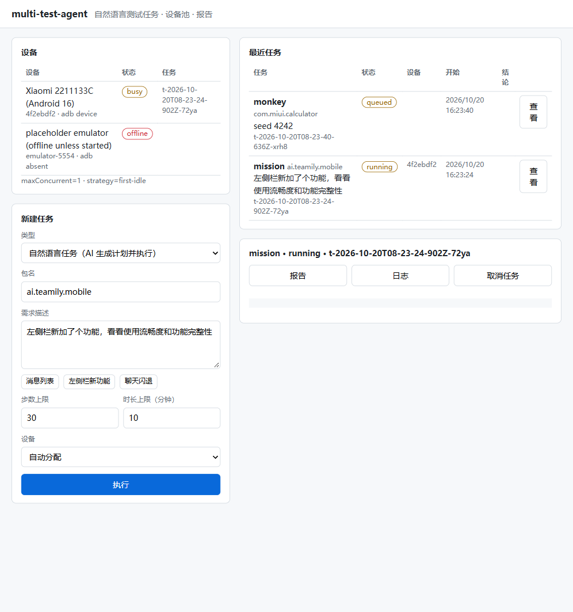

# multi-test-agent

> 项目介绍页：[docs/intro.html](docs/intro.html)（浏览器直接打开）· 验收证据：[docs/m6-acceptance.md](docs/m6-acceptance.md)（本轮）/ [docs/m5-acceptance.md](docs/m5-acceptance.md) · 历史变更：[CHANGELOG.md](CHANGELOG.md)

Teamily 客户端测试台：在 **Android App、手机自带浏览器里的 Web、手机视口 Web、桌面 Web（Windows 上为 Edge 最大化窗口）** 四个执行端上，以**黑盒**方式（只做用户能做的操作、只看用户能看到的现象）复现和验收问题，并留下可回放的证据；多个端可各登录一个账号，在同一会话里做同步测试。

主线是 **Issue 驱动**：把一份 Issue 文档交给测试台，它会判断这是什么类型的问题、生成测试计划，经你确认一次后在生产环境执行，最后给出结论、证据包和报告。另有自然语言任务、AI 探索、Monkey、IM 界面层收发测试等入口，都在同一个控制台里。

## 现状一览（2026-10-22）

| 能力 | 状态 | 说明 |
|---|---|---|
| Issue 分类与计划 | ✅ 可用 | 10 份样例 Issue 全部分类；可执行的生成计划，服务端 / 空文档出拒绝报告，多账号 / 需新能力的出暂缓报告 |
| 黑盒执行（四个执行端） | ✅ 可用 | 按 SKILL 标定的坐标操作，动作间隔 ≤ 1 秒，一份 Issue 只启动一次 App；`android-web` = 手机自带浏览器，`desktop-web` 在 Windows 上用 Edge 最大化窗口 |
| 退出 / 杀进程 / 重新加载 | ✅ 可用 | 计划动作 `exitApp`（Home）、`idle`（后台等待，≤10 分钟）、`killApp`（杀进程并核实）、`launch`（冷/热启动）、`reload`；App 与手机浏览器都可用，计划内的退出不算闪退 |
| 动态目标 | ✅ 可用 | 用哪个群、哪条消息由模型在准备阶段看屏幕选定，冻结为坐标后进入循环 |
| 判定 | ✅ 可用 | 偶现：上限内命中 1 次即复现；必现：连续 3 次；需求：逐条验收出「已实现 / 部分实现 / 未实现」 |
| 证据复核 | ✅ 可用 | 检查类命中先把录屏（出事轮与前一轮的画面条 + 被判定的截图）交给视觉模型对照 Issue 的「实际结果」，不符合即排除、不计命中；预置用例 `fixtures/evidence/` 回归复核本身 |
| 事故现场包 | ✅ 可用 | Android：录屏环形缓冲（最多 6×30 秒）+ 时间窗日志 + 崩溃缓冲 + dropbox；Web：Playwright trace + console + 网络记录；单文件离线查看器 |
| 重放 | ✅ 可用 | 按同一判定规则给出能否复现，并指出从第几轮起偏离原路径 |
| 账号池 | ✅ 可用 | 测试 / 生产账号分开租用，光标登录并缓存会话；凭据只在本地私有文件 |
| 端点池 + 多端同步 | ✅ 可用 | `platform/devices.yaml`：手机与本机都是端点，按「端点 × 执行端」分槽租用；同一台手机可同时跑 App 和浏览器（轮流占前台），手机上登录的是哪个账号写在配置里；`pnpm autotest sync` 让各端用不同账号进同一会话互发互收 |
| 控制台 | ✅ 可用 | 上传 Issue → 生成计划 → 一次性确认（替代端复选框）→ 执行 → 报告与证据链接 |
| 自然语言任务 / AI 探索 / Monkey / imui | ✅ 可用 | 早期能力，保留不变 |
| iOS、WebView、小程序 | ❌ 未接入 | iOS 问题只能经确认后在 Android 或手机 Web 上替代执行 |
| 多角色 Issue 计划 | ⏸ 暂缓 | 同步底座已可用；1919 / 2235 这类 Issue 还未生成多角色计划 |

**生产环境样例结论**（详见 [docs/m5-acceptance.md](docs/m5-acceptance.md)）：

| Issue | 执行端 | 结论 |
|---|---|---|
| 1594 @ 选择器偶发不弹出 | desktop-web | 未复现（1000 步，最大间隔 918 ms，视觉模型调用 0） |
| 2336 三个独立通知铃铛 | desktop-web | 未实现：个人主页、Artifacts、CloudDoc 仍各有独立 🔔，无统一入口 |
| 2122 免打扰群 @ 我（单账号部分） | desktop-web | 未实现：无「@我 / Mentions」聚合，免打扰群无显著角标；需第二账号的部分暂缓 |
| 1329 点赞 / 定位链接 / 键盘（iOS） | android-app（替代） | 三项均未复现，各跑满 30 分钟。**更正**：开发期记为「已复现」的 s2（如 `1329-2026-10-21T16-43-05-544Z`）是误报——跳到的就是被引用消息，只是窄屏下被引用气泡换成两行、跳转后短暂高亮，基线像素比对没对上；现由证据复核排除，并固化为预置用例 |
| 1614 / 1922 | — | 拒绝执行（服务端问题 / 按文档约定） |
| 1919、2235 / 2230 | — | 暂缓（多账号 / 需构造浏览器存储） |

## 快速开始

环境：Node.js ≥ 18（已在 22 验证）、pnpm 12；一台开启 USB 调试的 Android 手机 + adb；OpenAI 兼容的模型接口；可选 scrcpy（录屏）、ffmpeg（合并视频、抽帧）、Java（仅 Allure 报告）。

```bash
pnpm install
pnpm exec playwright install chromium
cp .env.example .env                       # 填 MIDSCENE_MODEL_*；可选 SCRCPY_PATH、MIDSCENE_ADB_PATH
# 账号：platform/accounts.local.yaml（gitignored），格式见 platform/accounts/secret-backend.ts
pnpm autotest accounts check --env prod    # 光标登录并缓存会话
pnpm autotest skill calibrate --surface desktop-web --env prod   # 标定（每个执行端各一次，App 或 Web 改版后重做）
pnpm autotest skill calibrate --surface android-web --env prod   # 手机浏览器：用 devices.yaml 里登在浏览器上的账号
pnpm autotest skill smoke --surface android-app --lifecycle cold # 退出 → 后台等待 → 杀进程 → 冷启动
pnpm platform                              # 控制台 http://localhost:3210
```

## Issue 驱动的黑盒复现

```bash
pnpm autotest plan issues/1594.md                      # 预判类别 + 子用例 + 替代项，草稿写入 platform/plans/drafts/
pnpm autotest run --issue 1594 --yes                   # 无替代项时确认执行
pnpm autotest run --issue 1329 --approve s1,s3:mobile-web   # 有替代项：勾选子用例并选执行端
pnpm autotest replay <incident>/replay.json --variant all   # 重放：原节奏 / 加速 / 减速 / 冷启动
```

流程：

1. **解析与分类**：读 `issues/*.md` 的各段落，规则优先、模型兜底，分为必现 / 偶现 / 需求 / 疑似误操作 / 服务端 / 多账号 / 未来计划 / 不可执行。人工决定可写入 `platform/issue-overrides.yaml`。
2. **计划**：输出 `TestPlan`（zod 定义，`platform/schema/test-plan.ts`），只引用 SKILL 的元素 id 和 Node，不写坐标。已在设备上验证过的 SKILL 模板优先，其余情况由模型生成，统一经规则校验。
3. **一次性确认**：控制台或命令行展示类别、子用例和替代理由；只执行勾选项，执行中不再打断。
4. **执行**：租用账号（Android 同时租用设备）→ 启动一次 → 比对首页参考区域（不一致即报「SKILL 失效」并停止）→ 选定动态目标 → 前置操作 → 循环。
   - 每步不截图、不发额外 adb 命令。异常门只看事件流：Android 读 logcat（崩溃、ANR、进程死亡、离开 App），Web 读页面事件。
   - 每轮末尾截一次图，与参考区域比对笔画；对不上才调视觉模型核对。不在预期页面时记为操作偏离，重新进入，不计命中。
5. **报告**：`midscene_run/issues/<id>-<时间>/` 下的 `report.md`、`result.json`，以及每次命中的现场包；同时写 Allure 结果。

现场包结构见 [skills/teamily/report-spec.md](skills/teamily/report-spec.md)。

## 证据复核与预置用例

```bash
pnpm autotest evidence review <incident 目录>          # 对一个现场包做复核，写 review/review.md
pnpm autotest evidence snapshot <incident 目录> --id <用例> --expect consistent|inconsistent --note "…"
pnpm autotest evidence cases                           # 跑 fixtures/evidence/ 下全部预置用例，结论不符即失败
```

- 执行中：检查类命中（基线 / 参考区域 / ai 检查失败）写完现场包后立即复核。画面条取出事轮和前一轮（参考）：动作前 2.5 秒到动作后 4 秒、每 0.75 秒一帧，外加被判定的那张截图；视觉模型按 Issue 的「实际结果」回答是否出现该现象，3 票多数。
- 「不符」→ 排除（报告「证据复核排除」一节，附画面所见与复核页），不计命中；连续 3 次被排除视为检查本身失效，停止并记「执行失败」。崩溃 / ANR / 进程死亡不经复核。
- 视觉模型不可用时命中照常计数，但标注「未能复核」。
- 预置用例：`1329-s2-quote-wrap`（真实误报，期望「不符」）与 `1329-s2-synthetic-old-jump`（阳性对照：同一录屏截到点击前，接上真机同群聊 30 屏前的历史截图，期望「符合」），防止复核退化成一律「不符」。
- 录屏对齐：分段起点改取 scrcpy 打印「Recording started」的时刻（此前取进程启动时刻，忙时晚约 2 秒），多段合并后按各段实际时长换算时间轴；ops.srt、查看器跳转、复核取帧都用同一换算。

## 多端同步测试（端点池 × 账号池）

```bash
pnpm autotest sync                                       # 默认 desktop-web + android-web + android-app，各一个账号
pnpm autotest sync --roles desktop-web,android-app --rounds 4 --timeout 60
```

- 端点：手机（adb 序列号）提供 `android-app`、`android-web` 两个槽；本机 `host:local` 提供 `desktop-web`（Edge）、`mobile-web`。一个任务可同时持有多个槽，`maxConcurrent` 按任务计。
- 账号：手机上的登录跟着手机走，`devices.yaml` 的 `accounts` 写明 App / 浏览器上各登的是哪个池账号，租用时只给这个账号；本机端从剩下的空闲账号里取，保证各端账号不同。
- 同一台手机的 App 与浏览器轮流占前台：对某端操作前先把它切到前台，另一端被告知「前台是主动让出的」，不会被记成离开 App。
- 每端准备：启动 → 登录（浏览器按需光标登录）→ 回到会话列表 → 模型按指引选同一个群（后面的端按第一端选中的标题找）→ 打开并滚到最新。
- 每轮一端发送一条唯一文本，其余端轮询直到看到或超时；App 端读无障碍文本核对，Web 端用视觉模型看截图（不读页面 DOM）。报告：每轮每端是否可见、从发送到看到的时间（含切换前台与核对耗时，是上界）、截图。
- 控制台「新建任务」里也有「多端同步」。

## Teamily SKILL（`skills/teamily/`）

- `SKILL.md`、`pages/*.md`：页面地图与元素清单；`vocab.ts`：元素 id / 参考区域 / Node / 动态目标指引的唯一来源。
- `profiles/<端>@<环境>.json`：标定坐标与自检结果。测试环境和生产环境前端布局不同，分别标定。Android 两端按手机区分：`android-<序列号>@env`（App）、`android-web-<序列号>@env`（浏览器）；`desktop-web@env` 记录标定时 Edge 最大化窗口的实际视口（本机 2040×1148 CSS px，缩放 1.25）。
- `refs/<profile>/`：参考截图；自检失败时生成标注图，只有失败项需要人工复核。
- `nodes.ts`：`teamily.login / openConversation / sendMessage / typeMention / clearComposer / switchConversation / openPage`（`pnpm autotest nodes` 列出）。
- `plan-template.md`：类别 → 计划骨架，以及 @ 选择器、点赞、键盘、引用定位、通知入口、@我 聚合等通用模板。

## 其他入口

| 命令 | 用途 |
|---|---|
| `pnpm autotest mission "聊天时偶发闪退，你试试能不能重现"` | 自然语言任务：模型生成计划，用视觉 AI 动作执行（探索模式） |
| `pnpm autotest explore --package <pkg>` | AI 探索遍历，按界面状态去重，有界步数 |
| `pnpm autotest monkey --package <pkg> --seed 12345` | 固定 seed 的 Monkey + logcat 交叉验证（不要对生产账号跑） |
| `pnpm autotest imui run --client …` | IM 消息在真实界面上的收发耗时、丢失、重复、乱序，见 [docs/imui.md](docs/imui.md) |
| `pnpm autotest skill smoke --surface <端>` | 冒烟：按坐标打开会话并发一条消息（发到自己的 Personal AI）；`--lifecycle warm` / `cold` 为退出 / 杀进程 / 重开 |
| `pnpm autotest sync …` | 多端同步测试（见上） |
| `pnpm autotest evidence …` | 证据复核与预置用例（见上） |
| `pnpm autotest accounts list` / `pnpm autotest devices` | 账号池 / 设备池状态 |
| `pnpm test:unit` / `pnpm typecheck` / `pnpm test:web` / `pnpm test:android` | 单测 / 类型检查 / Web 与 Android 基线用例 |
| `pnpm report` | 生成 Allure 报告（需要 Java） |

## 控制台（`pnpm platform`）

单个 `node:http` 服务加单页 HTML，没有前端构建链。

- **设备**：`platform/devices.yaml`（手机 + 本机端点、各执行端的槽、手机上登录的账号）与 `adb devices` 合并，显示 idle / busy / offline。
- **新建任务**：Issue 黑盒复现 / 验收、多端同步、自然语言任务、AI 探索、Monkey、IM 界面层收发。
- **最近任务**：实时日志、渲染后的报告（截图与现场包可直接打开）、取消。

状态落盘在 `platform/state/`，没有数据库。



## 原则与安全

- **黑盒**：不读源码、不装调试版、不向页面注入代码，也不连调试端口（手机浏览器只用 adb 输入和截屏）。读取页面结构 / 无障碍层只发生在标定和准备阶段，用于找元素和候选目标；检查点上 App 可读无障碍文本核对（引用定位、同步收发），Web 只看截图。
- **生产环境**：结论以生产环境为准，测试环境只用于标定和调试。账号池里的生产账号都是测试账号，同步测试发出的消息留在测试群里，不撤回；循环中仍不做会打扰他人的操作。
- **凭据**：只存在于 `platform/accounts.local.yaml` 和 `platform/secrets/`（均 gitignored），不进日志、报告、提交。
- **硬拦截**：支付类操作始终禁止。

## 已知限制

- 手机浏览器（`android-web`）：浏览器只在页面加载时建立无障碍树，页面内跳转后不更新，标定时用浏览器自带刷新重新加载后再读，临时出现的元素（密码页、@ 选择器、输入时的发送键）由视觉模型定位；软键盘会盖住表单按钮，登录用键盘回车提交；系统返回键会关闭标签页，执行中只用页面里的返回。
- Teamily Web（产品侧现象，已记录）：页面重新加载后会自动打开上次的会话，而这时会话左上角的返回按钮无效（它做的是浏览器历史后退，历史为空）；用户只能经 Artifacts → 聊天 → 返回回到列表，执行器就按这条路径恢复。
- Edge 下新登录的账号会被要求完成 5 步新手引导（`/onboarding?required=1`，Chromium 无头模式下不出现）；测试账号已各走过一次。
- 多端同步的耗时含切换手机前台与核对（视觉约 5 秒）的时间，只作上界参考，不是消息时延。
- 同步测试检出的产品现象：App 进后台期间收到的消息，回到前台 60 秒内不显示，App 自己发一条后才补到，且排在自己那条之后（顺序错乱）；手机单机两端 7 次中 5 次复现、1 次 18 秒才显示（等 40 秒再发也一样）；App 在前台时 3 秒内正常收到。见 `docs/m6-acceptance.md`。
- 槽位租用记在各自进程里：控制台与命令行同时对同一台手机下任务会冲突。
- 任务默认时限 15 分钟（计划 `limits.maxMinutes`、控制台硬上限）。

- 视觉模型适合准备阶段挑目标，不适合直接下结论；判定优先用参考区域比对和无障碍层核对，视觉判断只作补充。
- 需要前置数据的用例（如引用定位）依赖会话中已有的数据；测试台还不能自行可靠地构造前置条件。
- 判定为「未复现」不等于没有问题，报告会写明执行了多少步、因何停止。
- 多账号、多端联动的 Issue（1919、2235、2122 的一部分）：同步底座已具备，但 Issue 计划还不会生成多角色步骤，仍为暂缓。
- CI 工作流（`.github/workflows/ai-test.yml`）只做过语法检查，未在真实 runner 上跑过。

## 目录结构

```
issues/            样例 Issue
issue/             解析、分类、计划生成、校验、报告、CLI
executor/          执行器：循环、判定、检查点、准备阶段选目标；sync.ts 多端同步
drivers/           黑盒驱动：web.ts（光标 / 触屏 / 键盘；Windows 上 Edge 最大化）、android.ts（常驻 adb shell + logcat 异常门；App 与浏览器）、factory.ts
incident/          飞行记录器（Android / Web）、现场包、离线查看器、坐标重放、证据复核（evidence-review / evidence-cases）
fixtures/evidence/ 证据复核预置用例（截取的录屏 + 元数据 + 期望结论）
skills/teamily/    Teamily SKILL：页面地图、profile、参考截图、Node、计划模板
skills/            标定工具（calibrate-web.ts、calibrate-android.ts、calibrate-android-web.ts）、profile 读写
platform/          控制台、任务调度、设备池、账号池（accounts/）、TestPlan schema（schema/）、计划（plans/）
mission/ explore/ monkey/ imui/ report/   其他测试入口
core/              adb 封装、logcat 监控、PNG 解码与区域比对
bin/autotest.ts    统一命令入口；scripts/ 各命令实现
tests/             Web / Android 基线用例
docs/              介绍页、imui 说明、验收证据
```

## 依赖

`@midscene/web`、`@midscene/android`、`@midscene/core`（Node 定义）、`playwright`、`vitest`、`allure-vitest`、`zod`、`js-yaml`、`dotenv`；adb、scrcpy、ffmpeg 通过子进程调用。
